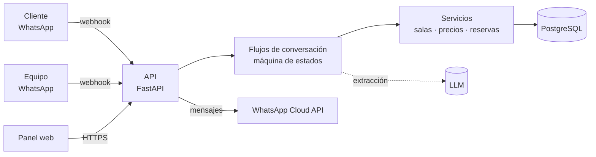

# AutoBooking — Showcase

> **Esto es una muestra (maqueta) de un proyecto real en producción.**
> El código del producto es privado. Este repositorio solo enseña la **idea**, la
> **arquitectura** y una **demo mínima** del flujo de conversación, con datos inventados y
> lógica simplificada a propósito.

SaaS multi-negocio para **reservar salones de eventos por WhatsApp** (bodas, comuniones,
cumpleaños…), con un **panel web** para que el equipo del salón gestione reservas, precios y
disponibilidad.

## La idea

1. El cliente escribe por WhatsApp en lenguaje natural: *«Hola, queremos celebrar una comunión el
   14 de junio, seremos unos 80»*.
2. El bot entiende lo que ya ha dicho y **solo pregunta lo que falta** (tipo de evento, fecha,
   invitados, sala, nombre).
3. Le enseña las salas libres ese día, sus fotos y el precio de la que elige.
4. Le deja añadir extras y le muestra un resumen para confirmar.
5. El equipo del salón recibe el aviso y gestiona la reserva desde WhatsApp o desde el panel.

```
Cliente  ▸ Hola, queremos hacer un cumpleaños
Bot      ▸ ¡Genial! ¿Para qué fecha?
Cliente  ▸ el 12 de abril
Bot      ▸ ¿Cuántos invitados seréis aproximadamente?
Cliente  ▸ entre 40 y 50
Bot      ▸ Estas salas están libres ese día: 1) Salón Jardín  2) Sala Cristal
Cliente  ▸ 2
Bot      ▸ Sala Cristal para 50 invitados: 900 €. ¿A nombre de quién?
...
```

## Qué incluye el producto real (resumen)

- Conversación guiada por WhatsApp (WhatsApp Cloud API) con extracción de datos asistida por IA
  y **reglas deterministas** que tienen la última palabra (fechas, números, importes).
- Precios por sala, días de la semana, tipo de evento y temporada.
- Extras, cupones, encuesta de origen del cliente y recordatorios.
- Ciclo de vida de la reserva con fianza y cambios de estado automáticos.
- Modo equipo por WhatsApp y panel web con calendario, roles y permisos.
- Multi-negocio, CRM básico y funcionalidades por plan.

Nada de eso está implementado aquí más allá de lo necesario para la demo.

## Arquitectura (alto nivel)



Más detalle en [docs/architecture.md](docs/architecture.md).

## Stack del producto

Python · FastAPI · PostgreSQL · WhatsApp Cloud API · LLM para extracción · HTML/CSS/JS sin
framework para el panel.

## Estructura de esta muestra

```
app/
  main.py                 API FastAPI: /health y /demo/chat
  flows/customer_flow.py  máquina de estados simplificada del cliente
  services/catalog.py     salas y tipos de evento de ejemplo (en memoria)
  services/pricing.py     precio por tramos de invitados (simplificado)
scripts/chat_demo.py      conversación en la terminal
tests/                    tests de la demo
docs/architecture.md      diagramas
```

## Probar la demo

```bash
python -m venv venv
venv\Scripts\activate          # Windows  (Linux/macOS: source venv/bin/activate)
pip install -r requirements.txt

python scripts/chat_demo.py    # chatear con el bot en la terminal
uvicorn app.main:app --reload  # API en http://localhost:8000/docs
pytest
```

## Licencia

© Todos los derechos reservados. El código se publica solo para su consulta como portfolio;
no se concede permiso para copiarlo, modificarlo ni usarlo. Ver [LICENSE](LICENSE).
