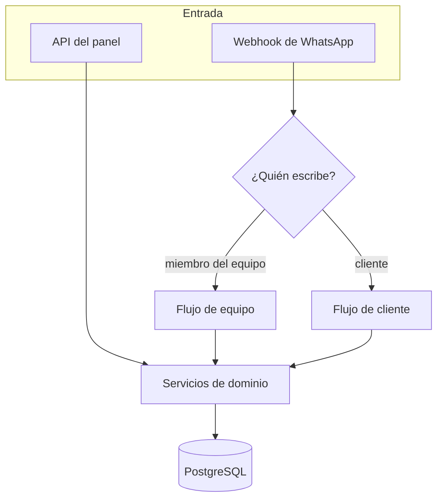
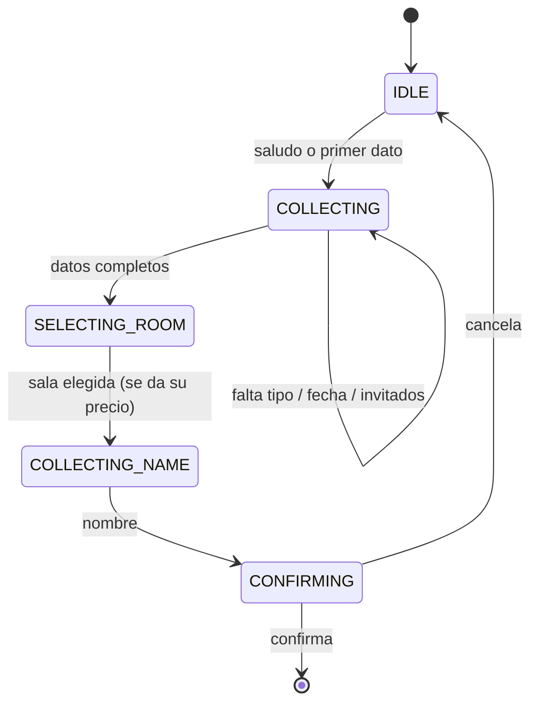
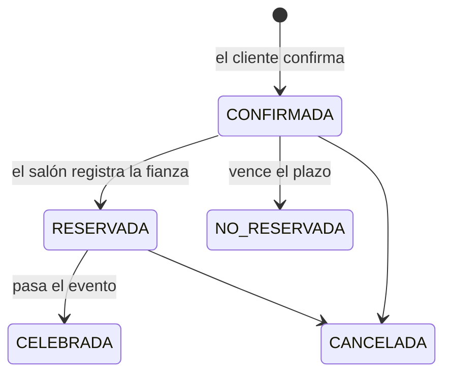

# Arquitectura

Vista general del producto real. Esta muestra solo implementa una versión reducida del flujo del
cliente.

## Canales

- **Un número de WhatsApp por negocio**: el mensaje entrante identifica el negocio y, dentro de
  él, si quien escribe es del equipo o un cliente.
- **Servicios compartidos**: WhatsApp y el panel usan las mismas reglas de negocio, así no hay
  dos versiones de la verdad.

## Conversación del cliente

Principios de diseño:

- **Determinista antes que IA**: la IA solo ayuda a extraer datos del texto libre; las fechas,
  los números y los precios se validan con reglas.
- **Las elecciones de listas llegan como identificadores**, no como texto libre.
- **Solo se pregunta lo que falta**: si el primer mensaje ya trae datos, se aprovechan.

## Ciclo de vida de una reserva (simplificado)

